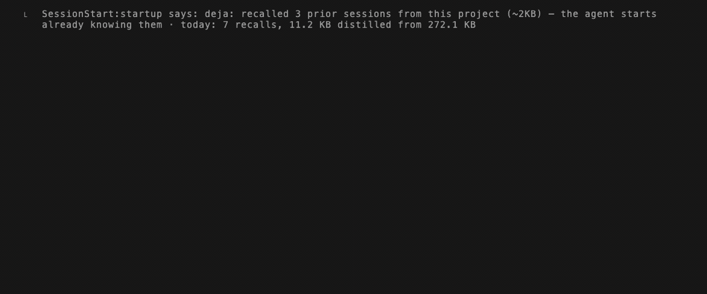

# deja-memory для Hermes

[English](../README.md) | [简体中文](zh.md) | [繁體中文](zh-TW.md) | [日本語](ja.md) | [한국어](ko.md) | [Español](es.md) | [Português](pt.md) | [Français](fr.md) | [Deutsch](de.md) | Русский | [Türkçe](tr.md) | [हिन्दी](hi.md)

[](https://trendshift.io/repositories/83640) [](https://github.com/vshulcz/deja-vu/stargazers)

Часть **[deja-vu](https://github.com/vshulcz/deja-vu)** (**97.2% R@5** на LongMemEval-S · **13.6 с** на индекс 19,195 сессий · **вдвое меньше токенов**, чем у agentmemory) · [Документация](https://vshulcz.github.io/deja-vu/guide/getting-started.html) · [Живое демо](https://vshulcz.github.io/deja-vu/view/) · [Бенчмарки](https://vshulcz.github.io/deja-vu/guide/benchmarks.html) · **[★ Звезда на GitHub](https://github.com/vshulcz/deja-vu)**

Провайдер памяти для Hermes, который отвечает по сессиям разработки, уже лежащим на этой машине: Claude Code, Codex, Cursor, сам Hermes и остальные агенты, которые читает deja — включая месяцы до установки каких-либо инструментов. Никакой модели, API-ключа или фонового сервера: историю локально индексирует единый Go-бинарник [deja](https://github.com/vshulcz/deja-vu).



## Установка

Сначала убедитесь, что `deja` доступен в `PATH`:

```bash
brew install deja-vu        # или: curl -fsSL https://raw.githubusercontent.com/vshulcz/deja-vu/main/install.sh | sh
deja install --auto         # подключает Hermes и всех поддерживаемых агентов на машине
hermes plugins install deja-memory   # или с GitHub: hermes plugins install vshulcz/deja-vu/extensions/hermes
hermes config set memory.provider deja-memory
```

или выберите `deja-memory` в `hermes memory setup` — мастер проверит наличие бинарника перед включением провайдера.

## Что он делает

- **Перед первым ходом сессии**: передаёт Hermes ту же сводку по проекту, которую хуки deja дают Claude Code и Codex — недавнюю работу и принятые решения. Дальше подключается только тогда, когда текущий вопрос перекликается с прошлым опытом; в большинстве ходов ничего лишнего не добавляется.
- **Прозрачность источника**: строки, которые deja выводит в Claude Code (квитанция с указанием агента-источника, сводка старта сессии, заметки о сборке и недельные заметки), идут через строку отклика Hermes `🧠 deja · …` в интерактивной CLI и `hermes chat -q`. Текст ответа модели не меняется. В Hermes 0.17 нет строки отклика, `hermes -z` и `hermes chat -Q` ничего не печатают, TUI лишь мелькает ею в строке состояния, а шлюзовый чат может оказаться группой с другими участниками — поэтому там deja придерживает заметки до подходящей сессии.
- **Без автоподсказок в `cron`**: когда Hermes сообщает платформу `cron`, провайдер сам ничего не добавляет, но при прямом вызове инструментов deja из задачи они отвечают как обычно.
- **Три инструмента**: `deja_recall` ищет по прошлым сессиям, `deja_fix` показывает, что запускали после такой же ошибки в прошлый раз, а `deja_blame` перечисляет сессии, правившие файл.
- **Приоритет заметок**: записи, добавленные Hermes в `MEMORY.md` или `USER.md`, также сохраняются как заметки deja и ранжируются выше соседних сессий.
- **Сжатие контекста**: при компакции сохраняет, на чём остановилась сессия, для следующего хода, а в конце сессии снимает её активную метку.

Одну вещь провайдер памяти сделать сам не может: подставить прошлое исправление прямо рядом со свежей ошибкой команды. Это работает через плагин-хук `transform_tool_result`, тогда как Hermes отдаёт провайдеру памяти контекст, в котором `register_hook` ничего не делает (`plugins/memory/__init__.py`, 0.17.0). Команда `deja install hermes-auto` ставит плагин с этим хуком.

Он никуда не дублирует ходы Hermes: Hermes сам пишет их на диск, а deja считывает при следующем обновлении индекса.

## Бенчмарки

| Полнота (Recall) | Расход токенов | Индексация и поиск |
|---|---|---|
| **97.2% R@5** на LongMemEval-S (88.9% hit@1 на 470 вопросах; у MemPalace заявлено 96.6%, у agentmemory — 95.2%) | **на 58% меньше токенов** (**вдвое меньше токенов**, чем у agentmemory на повторных задачах) | **13.6 с** на индекс 19,195 сессий / **0.7 мс** на поиск по 48 кодинг-агентам (следующий из 7 инструментов: 72 с) |

## Память в репозитории и передача сессии (`handoff`)

Делитесь проверенными решениями и тупиковыми ветками через git в `.deja/memory.jsonl` (`deja repo candidates`, `deja repo add <id>`). Записи очищаются от секретов при записи, хранятся отсортированными с `merge=union` для беспроблемного слияния веток и подгружаются у каждого, кто клонирует репозиторий (`{"activations":{"auto":{"repo":false}}}` в политике доверия отключает подстановку через хуки). [Подробнее](https://vshulcz.github.io/deja-vu/guide/repo-memory.html).

Переключаетесь между инструментами посреди задачи? Выполните `deja handoff --to <agent>` (или вызовите `handoff` через MCP), чтобы передать цель сессии, принятые решения, затронутые файлы, пройденные проверки и оставшуюся работу другому агенту.

## Один код с `deja install`

`deja install hermes-auto` записывает этот провайдер в `~/.hermes/plugins/deja-memory` вместе с MCP-сервером и хук-плагином `pre_llm_call`. Файлы здесь сгенерированы из того же исходника (`cmd/deja/install_hermes_memory.go`); единственное отличие — эта копия ищет `deja` в `PATH`, а не жёстко зашивает путь. Тест `TestHermesExtensionIsTheProviderInstallWrites` падает при любом расхождении.

Часть [deja-vu](https://github.com/vshulcz/deja-vu). Лицензия MIT. Пригодилось? [Поставьте deja-vu звезду на GitHub](https://github.com/vshulcz/deja-vu).
