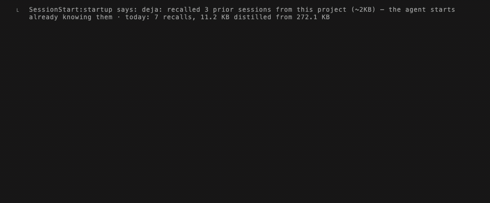

# deja-vu for VS Code, Cursor, Windsurf & Antigravity

English | [简体中文](https://github.com/vshulcz/deja-vu/blob/main/extensions/vscode/docs/zh.md)

**Your coding agents stop re-debugging what you already fixed.**

[deja-vu](https://github.com/vshulcz/deja-vu) indexes the session transcripts Claude Code, Cursor, Codex, Windsurf, Copilot Chat, OpenCode, Cline, Roo Code and 35 other coding agents already write to disk — locally, in one Go binary, with no LLM and no background daemon.

**[★ Star deja-vu on GitHub](https://github.com/vshulcz/deja-vu)** · **[Documentation](https://vshulcz.github.io/deja-vu/guide/getting-started.html)** · **[Benchmarks](https://vshulcz.github.io/deja-vu/guide/benchmarks.html)**



## What this extension does

Shows live `deja statusline` state in the IDE status bar (sessions indexed across your agents, memory recalls served today, and workspace history). If `deja` is not installed yet, clicking the status bar item runs `npx -y @vshulcz/deja-vu install --auto` in a terminal to wire all detected agents on your machine.

## Quick install

```sh
brew install deja-vu && deja install --auto
# or without Homebrew:
npx -y @vshulcz/deja-vu install --auto
```

Install the status bar extension from the CLI:

```sh
code --install-extension vshulcz.deja-status
```

## Measured impact

| Benchmark | Result |
|---|---|
| Task token cost on repeated repository work | **58% fewer tokens** (`52,815` vs `103,443` cold, 11 paired runs) |
| LongMemEval-S retrieval accuracy (470 cleaned questions) | **88.9% hit@1** |
| In-process lexical query latency | **0.7–0.8 ms** median |
| Day-zero indexing over 19,195 real sessions | **13.6 s**, zero API keys |

## License

MIT — [github.com/vshulcz/deja-vu](https://github.com/vshulcz/deja-vu)
