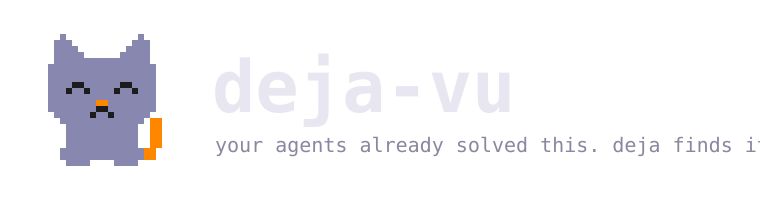

<p align="center">
  <picture>
    <source media="(prefers-color-scheme: dark)" srcset="https://raw.githubusercontent.com/vshulcz/deja-vu/main/assets/logo-dark.svg">
    
  </picture>
</p>

<p align="center"><strong>Instant local memory for 52 coding agents — reads the session logs already on your disk.</strong></p>

<p align="center"><a href="https://github.com/vshulcz/deja-vu#readme">English</a> | <a href="https://github.com/vshulcz/deja-vu/blob/main/docs/readme/README.zh.md">简体中文</a> | <a href="https://github.com/vshulcz/deja-vu/blob/main/docs/readme/README.zh-TW.md">繁體中文</a> | <a href="https://github.com/vshulcz/deja-vu/blob/main/docs/readme/README.ja.md">日本語</a> | <a href="https://github.com/vshulcz/deja-vu/blob/main/docs/readme/README.ko.md">한국어</a> | <a href="https://github.com/vshulcz/deja-vu/blob/main/docs/readme/README.es.md">Español</a> | <a href="https://github.com/vshulcz/deja-vu/blob/main/docs/readme/README.pt.md">Português</a> | <a href="https://github.com/vshulcz/deja-vu/blob/main/docs/readme/README.fr.md">Français</a> | <a href="https://github.com/vshulcz/deja-vu/blob/main/docs/readme/README.de.md">Deutsch</a> | <a href="https://github.com/vshulcz/deja-vu/blob/main/docs/readme/README.ru.md">Русский</a> | <a href="https://github.com/vshulcz/deja-vu/blob/main/docs/readme/README.tr.md">Türkçe</a> | <a href="https://github.com/vshulcz/deja-vu/blob/main/docs/readme/README.hi.md">हिन्दी</a></p>

<p align="center"></p>

Fifty-two coding agents — including Claude Code, Codex, Cursor, OpenClaw, Gemini CLI, opencode, Cline, Copilot CLI, Roo Code, Kilo Code, aider, Goose, Qwen Code, Kimi Code, Antigravity, Grok Build, pi, omp, DeepSeek Harness, Hermes, Kiro, Reasonix and Zed — already write every session to local files. **deja starts full**: it indexes months of history from before you installed it so your agents keep context across `/compact`, hand off mid-task via `deja handoff`, and recover overwritten code via `deja restore` and `deja blame` — with no model and no capture step.

One Go binary. No LLM, no embeddings, no API key. The network is used only by commands you run for it, such as `deja update` and `deja sync ssh`, and by a daily release check, which `DEJA_OFFLINE=1` turns off.
**58% fewer tokens** on repeated repository tasks (53,558 vs 126,222 baseline; 52,815 vs 103,443 in alternated 11-run trials). **97.2% R@5** on LongMemEval-S (**88.9% hit@1** on the 470-question cleaned set), and **13.6 s** to index 19,195 sessions (**0.7–0.8 ms** in-process lookup).

```sh
npx @vshulcz/deja-vu audit --secrets               # scan local logs for expiry & leaked keys, no install
npx @vshulcz/deja-vu "connection pool exhausted"   # search existing sessions, no install
npx @vshulcz/deja-vu install --auto                # stage ~/.local/bin/deja & wire every installed agent
```

`deja install --auto` wires MCP recall into every coding agent it finds on the
machine and turns on session-start recall where the agent supports it. Ten
seconds to install, about ten to index, and the next session already knows.
Use `--all` for the MCP tools without the session-start hook. `deja` on its own
opens a search screen over every agent's history, where you can read a session,
resume it, or continue it in another agent.

Or wire the stdio MCP server directly in any MCP client (`mcp.json` / `claude_desktop_config.json`):

```json
{
  "mcpServers": {
    "deja": {
      "command": "npx",
      "args": ["-y", "@vshulcz/deja-vu", "mcp"]
    }
  }
}
```

## Benchmarks

| Recall | Tokens | Index & lookup |
|---|---|---|
| **97.2% R@5** on LongMemEval-S (**88.9% hit@1** on the 470-question cleaned set) | **58% fewer tokens** on repeated repository tasks | **13.6 s** to index 19,195 sessions / **0.7–0.8 ms** in-process lookup across 52 coding agents |

## Repository memory & handoff

Share vetted project decisions and dead ends through git in `.deja/memory.jsonl` (`deja repo candidates`, `deja repo add <id>`). Entries are redacted on write, stored sorted with `merge=union` so parallel branches merge cleanly, and loaded for any teammate who clones the repository (`{"activations":{"auto":{"repo":false}}}` in the trust policy keeps them out of hooks). [More](https://vshulcz.github.io/deja-vu/guide/repo-memory.html).

Switching tools mid-task? Run `deja handoff --to <agent>` (or use `handoff` via MCP) to transfer the active session's goal, decisions, touched files, passed checks, and open work into another coding agent.

Full documentation, the harness matrix and the benchmarks:
[github.com/vshulcz/deja-vu](https://github.com/vshulcz/deja-vu) ·
[vshulcz.github.io/deja-vu](https://vshulcz.github.io/deja-vu/)

MIT
