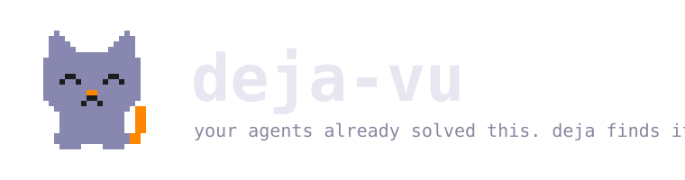
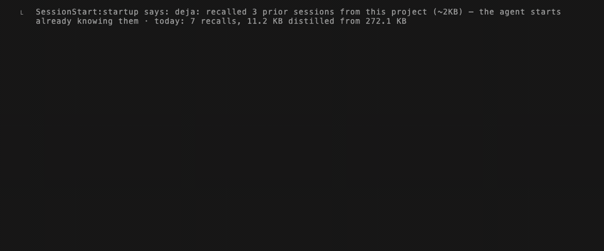

<p align="center">
  <picture>
    <source media="(prefers-color-scheme: dark)" srcset="https://raw.githubusercontent.com/vshulcz/deja-vu/main/assets/logo-dark.svg">
    
  </picture>
</p>

<p align="center"><strong>Shared local memory, session history search, cross-agent handoff, and code recovery across 43 coding agents.</strong></p>

<p align="center"></p>

Forty-three coding agents — including Claude Code, Codex, Cursor, OpenClaw, Gemini CLI, opencode, Cline, Copilot CLI, Roo Code, Kilo Code, aider, Goose, Qwen Code, Kimi Code, Antigravity, Grok Build, pi, omp, DeepSeek Harness, Hermes, Kiro, Reasonix and Zed — already write every session to local files. **deja starts full**: it indexes months of history from before you installed it so your agents keep context across `/compact`, hand off mid-task via `deja handoff`, and recover overwritten code via `deja restore` and `deja blame` — with no model and no capture step.

One Go binary. No LLM, no embeddings, no API key. The network is used only by commands you run for it, such as `deja update` and `deja sync ssh`, and by a daily release check, which `DEJA_OFFLINE=1` turns off.
**58% fewer tokens** on a task this machine had already solved (53,558 against 126,222 with nothing wired, and 52,815 against 103,443 on a later build with the arms run alternately, eleven runs an arm each time). **97.2% R@5** on LongMemEval-S (**88.9% hit@1** on the 470-question cleaned set), **half the tokens** of agentmemory, and **13.6 s** to index 19,195 sessions across gigabytes of history.

```sh
npx @vshulcz/deja-vu audit                         # inspect local stores, retention risk & recoverable files, no install
npx @vshulcz/deja-vu "connection pool exhausted"   # search existing sessions, no install
npx @vshulcz/deja-vu install --auto                # stage ~/.local/bin/deja & wire every installed agent
```

`deja install --auto` wires MCP recall into every coding agent it finds on the
machine and turns on session-start recall where the agent supports it. Ten
seconds to install, about ten to index, and the next session already knows.
Use `--all` for the MCP tools without the session-start hook. `deja` on its own
opens a search screen over every agent's history, where you can read a session,
resume it, or continue it in another agent.

Or wire the stdio MCP server directly in any MCP client (`mcp.json` / `claude_desktop_config.json`):

```json
{
  "mcpServers": {
    "deja": {
      "command": "npx",
      "args": ["-y", "@vshulcz/deja-vu", "mcp"]
    }
  }
}
```

Full documentation, the harness matrix and the benchmarks:
[github.com/vshulcz/deja-vu](https://github.com/vshulcz/deja-vu) ·
[vshulcz.github.io/deja-vu](https://vshulcz.github.io/deja-vu/)

MIT

Found it useful? [Star deja-vu on GitHub](https://github.com/vshulcz/deja-vu).
